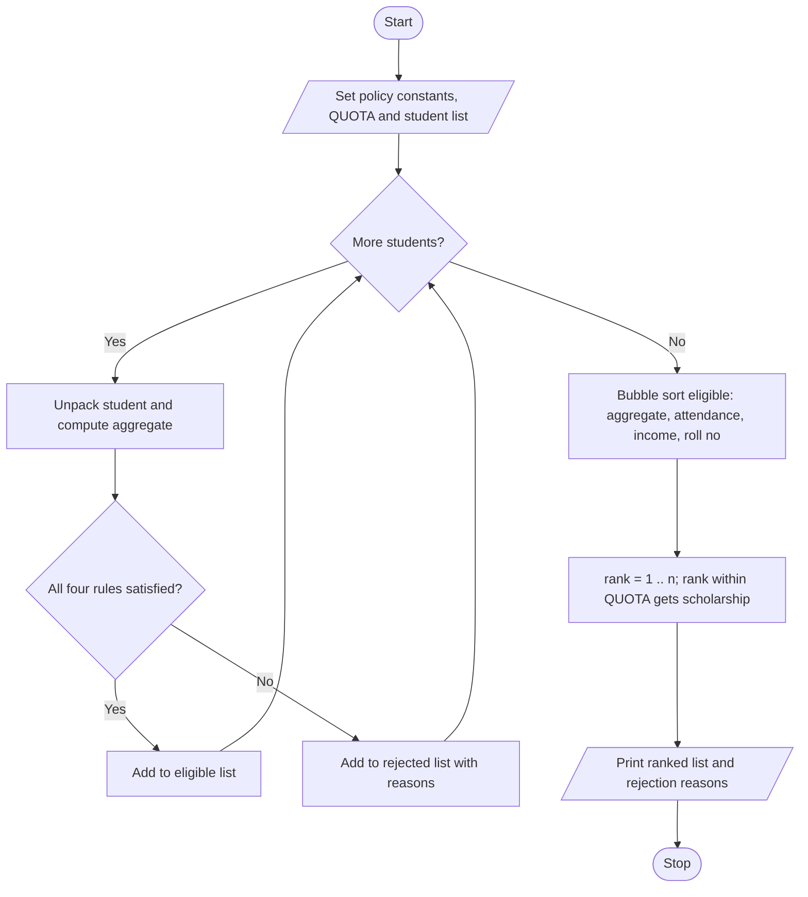

# Case Study 1: University Scholarship Allocation

[Back to main README](../README.md)

## 1. Problem Statement
A university offers a limited number of merit scholarships. Each applicant has subject marks, an attendance percentage and a yearly family income. Design a program that checks every applicant against the scholarship policy (aggregate marks, subject-wise minimum marks, attendance and income limit), ranks the eligible applicants, resolves ties using fixed rules, awards the scholarships within the quota and explains why each rejected applicant failed.

## 2. Objectives
- Apply four eligibility conditions to every applicant using conditional statements.
- Store applicants as tuples and use tuple unpacking to read their fields.
- Rank eligible applicants with a manual sort and a multi-level tie-breaking rule.
- Report every reason for rejection, not just the first one.

## 3. Assumptions
- Every student has marks in exactly 5 subjects, each out of 100.
- Aggregate = average of the 5 subject marks (percentage).
- Policy values: aggregate >= 75, each subject >= 50, attendance >= 75%, income <= Rs.5,00,000, quota = 3 (all stored in constants so they are easy to change).
- Tie-break order: higher aggregate, then higher attendance, then lower income, then smaller roll number.
- Data is hard-coded in the program (hypothetical students).

## 4. Algorithm
1. Define the policy constants, subject names, quota and the list of student tuples.
2. For each student, unpack the tuple and calculate the aggregate.
3. Check aggregate, each subject mark, attendance and income; add a reason to a list for each rule that fails.
4. If the reasons list is empty, add the student to the `eligible` list; otherwise add to `rejected` with the reasons.
5. Sort `eligible` with bubble sort using the tie-break order (aggregate, attendance, income, roll number).
6. Print the ranked list; ranks up to QUOTA get *SCHOLARSHIP AWARDED*, the rest *Waiting list*.
7. Print the rejected students with all their reasons.

## 5. Pseudocode
```text
START
  SET MIN_AGGREGATE, MIN_SUBJECT, MIN_ATTENDANCE, MAX_INCOME, QUOTA
  CREATE list students of tuples (roll, name, marks, attendance, income)
  CREATE empty lists eligible, rejected
  FOR each student IN students
      UNPACK roll, name, marks, attendance, income
      reasons = empty list
      aggregate = sum(marks) / number of marks
      IF aggregate < MIN_AGGREGATE THEN add reason
      FOR each mark IN marks
          IF mark < MIN_SUBJECT THEN add reason
      IF attendance < MIN_ATTENDANCE THEN add reason
      IF income > MAX_INCOME THEN add reason
      IF reasons is empty THEN append to eligible
      ELSE append to rejected
  END FOR
  FOR i = 0 TO n-2
      FOR j = 0 TO n-2-i
          IF eligible[j+1] should rank above eligible[j]
              (higher aggregate, else higher attendance,
               else lower income, else smaller roll number)
              SWAP them
  END FOR
  rank = 1
  FOR each student IN eligible
      IF rank <= QUOTA THEN status = "AWARDED" ELSE status = "Waiting list"
      PRINT rank, student details, status
      rank = rank + 1
  FOR each student IN rejected
      PRINT roll, name, all reasons
STOP
```

## 6. Flowchart


## 7. Python Source Code
File: [`programs/case01_scholarship_allocation.py`](../programs/case01_scholarship_allocation.py)

```python
# Case Study 1: University Scholarship Allocation
# Concepts used: lists, tuples, tuple unpacking, loops, conditionals

# ---------- Scholarship policy (change these to test) ----------
MIN_AGGREGATE = 75      # minimum aggregate percentage
MIN_SUBJECT = 50        # minimum marks needed in EVERY subject
MIN_ATTENDANCE = 75     # minimum attendance percentage
MAX_INCOME = 500000     # maximum yearly family income (Rs.)
QUOTA = 3               # number of scholarships available

SUBJECTS = ["Maths", "Physics", "Chemistry", "English", "Python"]

# Each applicant is a tuple: (roll no, name, [marks], attendance, income)
students = [
    ("S101", "Anil",   [85, 78, 92, 88, 90], 92, 300000),
    ("S102", "Bhavya", [80, 75, 85, 78, 82], 85, 200000),
    ("S103", "Charan", [90, 45, 88, 92, 85], 95, 250000),
    ("S104", "Divya",  [85, 78, 92, 88, 90], 92, 280000),
    ("S105", "Esha",   [88, 80, 79, 91, 77], 70, 150000),
    ("S106", "Farhan", [95, 90, 92, 89, 94], 96, 800000),
    ("S107", "Gita",   [60, 62, 58, 65, 61], 80, 100000),
    ("S108", "Hari",   [78, 81, 85, 79, 82], 88, 350000),
]

eligible = []   # tuples: (roll, name, aggregate, attendance, income)
rejected = []   # tuples: (roll, name, [reasons])

# ---------- Step 1: check eligibility of every student ----------
for student in students:
    roll, name, marks, attendance, income = student    # tuple unpacking
    reasons = []

    total = 0
    for m in marks:
        total = total + m
    aggregate = total / len(marks)

    if aggregate < MIN_AGGREGATE:
        reasons.append(f"Aggregate {aggregate:.1f} is below {MIN_AGGREGATE}")

    for i in range(len(marks)):
        if marks[i] < MIN_SUBJECT:
            reasons.append(f"{SUBJECTS[i]} marks {marks[i]} are below {MIN_SUBJECT}")

    if attendance < MIN_ATTENDANCE:
        reasons.append(f"Attendance {attendance}% is below {MIN_ATTENDANCE}%")

    if income > MAX_INCOME:
        reasons.append(f"Income Rs.{income} is above Rs.{MAX_INCOME}")

    if len(reasons) == 0:
        eligible.append((roll, name, aggregate, attendance, income))
    else:
        rejected.append((roll, name, reasons))

# ---------- Step 2: rank eligible students (bubble sort) ----------
# Tie-break order: higher aggregate -> higher attendance -> lower income -> smaller roll no
n = len(eligible)
for i in range(n - 1):
    for j in range(n - 1 - i):
        a = eligible[j]
        b = eligible[j + 1]
        swap = False
        if b[2] > a[2]:
            swap = True
        elif b[2] == a[2]:
            if b[3] > a[3]:
                swap = True
            elif b[3] == a[3]:
                if b[4] < a[4]:
                    swap = True
                elif b[4] == a[4]:
                    if b[0] < a[0]:
                        swap = True
        if swap:
            eligible[j], eligible[j + 1] = b, a

# ---------- Step 3: display results ----------
print("=== RANKED ELIGIBLE STUDENTS ===")
print(f"{'Rank':<5}{'Roll':<7}{'Name':<9}{'Aggr%':<8}{'Att%':<6}{'Income':<9}Status")
rank = 1
for item in eligible:
    roll, name, aggregate, attendance, income = item
    if rank <= QUOTA:
        status = "SCHOLARSHIP AWARDED"
    else:
        status = "Waiting list"
    print(f"{rank:<5}{roll:<7}{name:<9}{aggregate:<8.1f}{attendance:<6}{income:<9}{status}")
    rank = rank + 1

print("\n=== REJECTED STUDENTS ===")
for item in rejected:
    roll, name, reasons = item
    print(f"{roll} {name}:")
    for r in reasons:
        print("   -", r)
```

## 8. Sample Run
No input is needed; the data is stored in the program.

```text
=== RANKED ELIGIBLE STUDENTS ===
Rank Roll   Name     Aggr%   Att%  Income   Status
1    S104   Divya    86.6    92    280000   SCHOLARSHIP AWARDED
2    S101   Anil     86.6    92    300000   SCHOLARSHIP AWARDED
3    S108   Hari     81.0    88    350000   SCHOLARSHIP AWARDED
4    S102   Bhavya   80.0    85    200000   Waiting list

=== REJECTED STUDENTS ===
S103 Charan:
   - Physics marks 45 are below 50
S105 Esha:
   - Attendance 70% is below 75%
S106 Farhan:
   - Income Rs.800000 is above Rs.500000
S107 Gita:
   - Aggregate 61.2 is below 75
```

## 9. Test Cases
| TC | Scenario / Input | Expected Output | Result |
|----|------------------|-----------------|--------|
| TC1 | Default data (8 students, quota 3) | Rank 1 S104 Divya, Rank 2 S101 Anil (tie at 86.6 broken by lower income), Rank 3 S108 Hari; S102 on waiting list | Pass |
| TC2 | S103 Physics changed from 45 to 50 (exactly the minimum) | S103 becomes eligible (81.0); beats S108 (also 81.0) on attendance 95 vs 88, so S103 is Rank 3 | Pass |
| TC3 | QUOTA changed to 1 | Only S104 awarded; S101, S108, S102 are on the waiting list | Pass |
| TC4 | S106 income changed to 500000 (boundary value) | Income equal to the limit is allowed; S106 (aggregate 92.0) becomes Rank 1 | Pass |
| TC5 | MIN_AGGREGATE changed to 99 | Nobody is eligible; every student is rejected with 'Aggregate ... is below 99' | Pass |

## 10. Output Screenshot
Run `python programs/case01_scholarship_allocation.py`, take a screenshot of the terminal and save it as `screenshots/case01_scholarship_allocation.png`. Then it will appear below.


## 11. Conclusion
The program evaluates all four scholarship conditions, collects every reason for rejection and ranks the eligible students with a clear, deterministic tie-breaking policy. It showed how tuples keep each applicant's record together, how unpacking makes the code readable, and how a manual bubble sort can implement a multi-level ranking rule without any built-in sorting functions. Because the policy values are constants, the same program can be reused for a different scholarship by changing only the top few lines.
