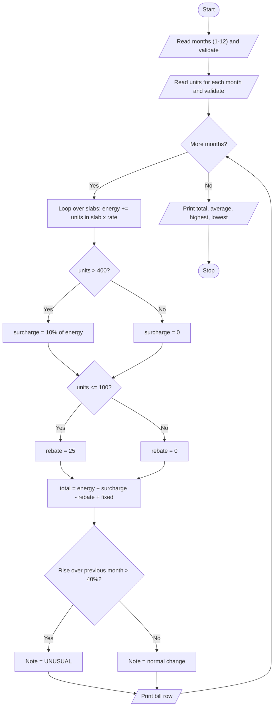

# Case Study 2: Progressive Electricity Billing

[Back to main README](../README.md)

## 1. Problem Statement
A household is charged for electricity using progressive slabs: the more units consumed, the higher the rate per unit. Besides the slab-wise energy charge, a fixed monthly charge is added, a surcharge applies to very high consumption and a rebate is given to very low consumption. Write a program that calculates the bill for several months, compares each bill with the previous month and flags unusual increases.

## 2. Objectives
- Implement slab-based (progressive) pricing using a loop over lists of limits and rates.
- Apply fixed charges, surcharge and rebate with conditional statements.
- Validate user input (number of months, units consumed).
- Compare consecutive months and identify unusual percentage increases.

## 3. Assumptions
- Slabs: 1-100 units at Rs.3.50, 101-200 at Rs.4.50, 201-400 at Rs.6.50, above 400 at Rs.8.00.
- Fixed charge = Rs.100 per month.
- Surcharge = 10% of the energy charge if units > 400.
- Rebate = Rs.25 if units <= 100.
- A bill is 'unusual' if it is more than 40% higher than the previous month's bill.
- Units are whole numbers; at most 12 months are processed.

## 4. Algorithm
1. Store slab limits, rates, fixed charge, surcharge and rebate rules as constants/lists.
2. Read the number of months (1-12) and the units for each month, validating each entry.
3. For each month, walk through the slabs: units used in a slab = min(remaining units, slab size); add used x rate; reduce remaining units.
4. Charge the remaining units (above the last limit) at the highest rate.
5. Add surcharge if units > 400; subtract rebate if units <= 100; add the fixed charge.
6. Compare with the previous month's bill: if the rise is above 40% print UNUSUAL.
7. After all months, print total, average, highest and lowest bills.

## 5. Pseudocode
```text
START
  SET SLAB_LIMITS = [100, 200, 400], SLAB_RATES = [3.5, 4.5, 6.5, 8.0]
  SET FIXED_CHARGE, SURCHARGE rules, REBATE rules, ALERT_PERCENT
  READ months  (repeat until 1 <= months <= 12)
  FOR i = 0 TO months-1
      READ units (repeat until it is a whole number)
      ADD units TO units_list
  END FOR
  FOR each month i
      remaining = units; previous_limit = 0; energy = 0
      FOR each slab s
          slab_size = SLAB_LIMITS[s] - previous_limit
          used = MIN(remaining, slab_size)
          energy = energy + used * SLAB_RATES[s]
          remaining = remaining - used
          previous_limit = SLAB_LIMITS[s]
      END FOR
      energy = energy + remaining * SLAB_RATES[3]
      IF units > 400 THEN surcharge = 10% of energy ELSE surcharge = 0
      IF units <= 100 THEN rebate = 25 ELSE rebate = 0
      total = energy + surcharge - rebate + FIXED_CHARGE
      IF i > 0 THEN
          increase = (total - previous total) / previous total * 100
          IF increase > ALERT_PERCENT THEN note = "UNUSUAL"
      PRINT row
  END FOR
  PRINT total, average, highest, lowest of all bills
STOP
```

## 6. Flowchart


## 7. Python Source Code
File: [`programs/case02_electricity_billing.py`](../programs/case02_electricity_billing.py)

```python
# Case Study 2: Progressive Electricity Billing
# Concepts used: lists, loops, conditionals, operators, formatted output

# ---------- Tariff details ----------
SLAB_LIMITS = [100, 200, 400]        # slab 1: 1-100, slab 2: 101-200, slab 3: 201-400
SLAB_RATES = [3.50, 4.50, 6.50, 8.00]  # rate per unit; last rate is for units above 400
FIXED_CHARGE = 100                   # fixed monthly charge (Rs.)
SURCHARGE_LIMIT = 400                # surcharge applies above this many units
SURCHARGE_PERCENT = 10               # % of energy charge
REBATE_LIMIT = 100                   # rebate for low consumers (units <= this)
REBATE_AMOUNT = 25                   # flat rebate (Rs.)
ALERT_PERCENT = 40                   # flag if bill rises by more than this %

MONTH_NAMES = ["Jan", "Feb", "Mar", "Apr", "May", "Jun",
               "Jul", "Aug", "Sep", "Oct", "Nov", "Dec"]

# ---------- Input with validation ----------
count_text = input("How many months (1-12)? ")
while (not count_text.isdigit()) or int(count_text) < 1 or int(count_text) > 12:
    count_text = input("Invalid. Enter months between 1 and 12: ")
months = int(count_text)

units_list = []
for i in range(months):
    text = input(f"Units consumed in {MONTH_NAMES[i]}: ")
    while not text.isdigit():
        text = input("Invalid. Enter a whole number of units (0 or more): ")
    units_list.append(int(text))

# ---------- Bill calculation ----------
bills = []
print(f"\n{'Month':<7}{'Units':<7}{'Energy':<10}{'Surch.':<9}{'Rebate':<8}{'Fixed':<7}{'Total':<10}Note")

for i in range(months):
    units = units_list[i]

    # Slab-wise energy charge
    remaining = units
    previous_limit = 0
    energy = 0.0
    for s in range(len(SLAB_LIMITS)):
        slab_size = SLAB_LIMITS[s] - previous_limit
        if remaining > slab_size:
            used = slab_size
        else:
            used = remaining
        energy = energy + used * SLAB_RATES[s]
        remaining = remaining - used
        previous_limit = SLAB_LIMITS[s]
    energy = energy + remaining * SLAB_RATES[3]     # units above the last limit

    surcharge = 0.0
    if units > SURCHARGE_LIMIT:
        surcharge = energy * SURCHARGE_PERCENT / 100

    rebate = 0
    if units <= REBATE_LIMIT:
        rebate = REBATE_AMOUNT

    total = energy + surcharge - rebate + FIXED_CHARGE
    bills.append(total)

    # Compare with previous month
    note = ""
    if i > 0:
        increase = (total - bills[i - 1]) / bills[i - 1] * 100
        if increase > ALERT_PERCENT:
            note = f"UNUSUAL +{increase:.1f}%"
        elif increase < 0:
            note = f"{increase:.1f}%"
        else:
            note = f"+{increase:.1f}%"

    print(f"{MONTH_NAMES[i]:<7}{units:<7}{energy:<10.2f}{surcharge:<9.2f}{rebate:<8}{FIXED_CHARGE:<7}{total:<10.2f}{note}")

# ---------- Summary ----------
highest = bills[0]
lowest = bills[0]
grand = 0
for b in bills:
    grand = grand + b
    if b > highest:
        highest = b
    if b < lowest:
        lowest = b
print(f"\nTotal of all bills : Rs.{grand:.2f}")
print(f"Average monthly bill: Rs.{grand / months:.2f}")
print(f"Highest bill: Rs.{highest:.2f}   Lowest bill: Rs.{lowest:.2f}")
```

## 8. Sample Run
Input used: Inputs in order: `6`, `90`, `120`, `180`, `260`, `430`, `310`

```text
How many months (1-12)? 6
Units consumed in Jan: 90
Units consumed in Feb: 120
Units consumed in Mar: 180
Units consumed in Apr: 260
Units consumed in May: 430
Units consumed in Jun: 310

Month  Units  Energy    Surch.   Rebate  Fixed  Total     Note
Jan    90     315.00    0.00     25      100    390.00    
Feb    120    440.00    0.00     0       100    540.00    +38.5%
Mar    180    710.00    0.00     0       100    810.00    UNUSUAL +50.0%
Apr    260    1190.00   0.00     0       100    1290.00   UNUSUAL +59.3%
May    430    2340.00   234.00   0       100    2674.00   UNUSUAL +107.3%
Jun    310    1515.00   0.00     0       100    1615.00   -39.6%

Total of all bills : Rs.7319.00
Average monthly bill: Rs.1219.83
Highest bill: Rs.2674.00   Lowest bill: Rs.390.00
```

## 9. Test Cases
| TC | Scenario / Input | Expected Output | Result |
|----|------------------|-----------------|--------|
| TC1 | 6 months: 90, 120, 180, 260, 430, 310 units<br>Inputs in order: `6`, `90`, `120`, `180`, `260`, `430`, `310` | Bills 390, 540, 810, 1290, 2674, 1615; Mar, Apr, May marked UNUSUAL; total Rs.7319.00 | Pass |
| TC2 | 1 month, 100 units (slab 1 boundary + rebate)<br>Inputs in order: `1`, `100` | Energy 350.00, rebate 25, total 425.00 | Pass |
| TC3 | 1 month, 400 units (no surcharge, because not above 400)<br>Inputs in order: `1`, `400` | Energy 2100.00, surcharge 0.00, total 2200.00 | Pass |
| TC4 | 1 month, 401 units (surcharge starts)<br>Inputs in order: `1`, `401` | Energy 2108.00, surcharge 210.80, total 2418.80 | Pass |
| TC5 | Invalid inputs: months 'abc' then 0 then 1; units 'x' then 0<br>Inputs in order: `abc`, `0`, `1`, `x`, `0` | Error messages shown, then 0 units: rebate 25 + fixed 100 gives total 75.00 | Pass |

## 10. Output Screenshot
Run `python programs/case02_electricity_billing.py`, take a screenshot of the terminal and save it as `screenshots/case02_electricity_billing.png`. Then it will appear below.


## 11. Conclusion
The program calculates progressive electricity bills correctly, including the boundary cases at 100, 400 and 401 units. Using lists for slab limits and rates made the slab calculation a single short loop instead of a long chain of if-else statements, and the month-to-month comparison highlighted sudden jumps in consumption. Input validation with while loops keeps the program from crashing on wrong entries.
