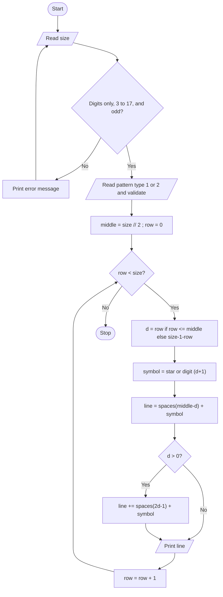

# Case Study 27: Advanced Numeric Pattern Generator (Hollow Diamond)

[Back to main README](../README.md)

## 1. Problem Statement
Write a program that prints a hollow diamond of a size chosen by the user. The diamond can be drawn with stars or with numbers, where each row's border shows the row number (1, 2, 3 ... up to the middle row and back down). The program must reject invalid sizes and keep the output carefully aligned.

## 2. Objectives
- Use nested loops/string repetition to build a symmetric pattern.
- Calculate the number of leading and inner spaces for each row.
- Validate input (non-numeric, too small, too large, even numbers).
- Offer two pattern styles (stars or numbers).

## 3. Assumptions
- Size means the number of rows and the width of the widest row; it must be an odd whole number from 3 to 17.
- The maximum is 17 so the numeric border never exceeds a single digit (it would be 9 at the middle row).
- The user can choose 1 (stars) or 2 (numbers).

## 4. Algorithm
1. Read the size as text and keep asking until it is all digits, between 3 and 17, and odd.
2. Read the pattern type and keep asking until it is 1 or 2.
3. Set middle = size // 2.
4. For each row from 0 to size-1, find d = distance from the top or bottom edge (d = row for the top half, size-1-row for the bottom half).
5. Choose the symbol: '*' for stars, or the digit (d+1) for numbers.
6. Start the line with (middle - d) spaces and the symbol.
7. If d > 0, add (2d - 1) inner spaces and the symbol again.
8. Print the line.

## 5. Pseudocode
```text
START
  READ size_text
  WHILE size_text is not valid
      IF not all digits THEN show error
      ELSE IF size < 3 OR size > 17 THEN show error
      ELSE IF size is even THEN show error
      READ size_text again
  END WHILE
  size = integer value of size_text
  READ choice  (repeat until choice is "1" or "2")
  middle = size DIV 2
  FOR row = 0 TO size-1
      IF row <= middle THEN d = row ELSE d = size - 1 - row
      IF choice = "1" THEN symbol = "*" ELSE symbol = (d + 1) MOD 10
      line = (middle - d) spaces + symbol
      IF d > 0 THEN line = line + (2*d - 1) spaces + symbol
      PRINT line
  END FOR
STOP
```

## 6. Flowchart


## 7. Python Source Code
File: [`programs/case27_hollow_diamond_pattern.py`](../programs/case27_hollow_diamond_pattern.py)

```python
# Case Study 27: Advanced Numeric Pattern Generator (Hollow Diamond)
# Concepts used: loops, nested loops, strings, conditionals, validation

MIN_SIZE = 3
MAX_SIZE = 17

# ---------- Read and validate the size ----------
text = input(f"Enter diamond size (odd number {MIN_SIZE}-{MAX_SIZE}): ")
while True:
    if not text.isdigit():
        text = input("Invalid: enter a positive whole number: ")
    elif int(text) < MIN_SIZE or int(text) > MAX_SIZE:
        text = input(f"Invalid: size must be between {MIN_SIZE} and {MAX_SIZE}: ")
    elif int(text) % 2 == 0:
        text = input("Invalid: size must be an ODD number: ")
    else:
        break
size = int(text)

# ---------- Choose the pattern type ----------
choice = input("Pattern type - 1 for stars, 2 for numbers: ")
while choice != "1" and choice != "2":
    choice = input("Invalid. Enter 1 or 2: ")

middle = size // 2          # index of the widest row

print()
for row in range(size):
    # distance of this row from the top/bottom edge of the diamond
    if row <= middle:
        d = row
    else:
        d = size - 1 - row

    if choice == "1":
        symbol = "*"
    else:
        symbol = str((d + 1) % 10)      # digit shown on the border of this row

    line = " " * (middle - d)           # left spaces for alignment
    line = line + symbol
    if d > 0:                           # rows with two border characters
        line = line + " " * (2 * d - 1) + symbol
    print(line)
```

## 8. Sample Run
Input used: Inputs in order: `7`, `1`

```text
Enter diamond size (odd number 3-17): 7
Pattern type - 1 for stars, 2 for numbers: 1

   *
  * *
 *   *
*     *
 *   *
  * *
   *
```

## 9. Test Cases
| TC | Scenario / Input | Expected Output | Result |
|----|------------------|-----------------|--------|
| TC1 | Size 5, stars<br>Inputs in order: `5`, `1` | 5-row hollow diamond; row 3 is the widest: `*   *` | Pass |
| TC2 | Size 3, numbers<br>Inputs in order: `3`, `2` | Rows: ` 1`, `2 2`, ` 1` pattern (1 at top, 2 and 2 in the middle, 1 at bottom) | Pass |
| TC3 | Size 4 (even) then 5<br>Inputs in order: `4`, `5`, `1` | Error: size must be an ODD number, then a 5-row diamond is printed | Pass |
| TC4 | Size 19 (too large) then 5<br>Inputs in order: `19`, `5`, `1` | Error: size must be between 3 and 17, then a valid diamond | Pass |
| TC5 | Text 'abc' and '-3', then 3, pattern type 7 then 1<br>Inputs in order: `abc`, `-3`, `3`, `7`, `1` | Both bad sizes rejected ('enter a positive whole number'); type 7 rejected ('Enter 1 or 2'); diamond of size 3 printed | Pass |

## 10. Output Screenshot
Run `python programs/case27_hollow_diamond_pattern.py`, take a screenshot of the terminal and save it as `screenshots/case27_hollow_diamond_pattern.png`. Then it will appear below.


## 11. Conclusion
The program generates a correctly aligned hollow diamond in either stars or numbers. The key idea was to measure each row's distance 'd' from the nearest edge: leading spaces are (middle - d) and inner spaces are (2d - 1), so one loop draws both halves of the diamond. Validation loops ensure only odd sizes from 3 to 17 are accepted, so the output never breaks.
