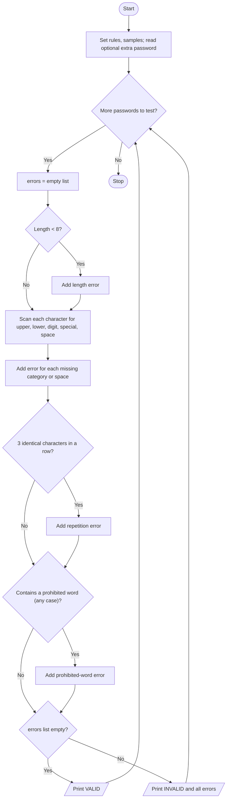

# Case Study 29: Password Policy Validation Engine

[Back to main README](../README.md)

## 1. Problem Statement
A website wants to enforce a password policy. Write a program that checks passwords against rules for minimum length, character categories, repeated characters, spaces and prohibited words, and which explains every rule that a password fails.

## 2. Objectives
- Examine strings character by character using loops.
- Use string methods (isupper, islower, isdigit, lower) and the `in` operator.
- Collect all failed conditions in a list and report them clearly.
- Test the policy on several sample passwords plus one entered by the user.

## 3. Assumptions
- Minimum length is 8 characters.
- Required: at least one uppercase letter, one lowercase letter, one digit and one special character from `!@#$%^&*()-_+=`.
- The same character must not appear 3 or more times in a row.
- Spaces are not allowed.
- Prohibited words (any case): password, admin, 1234, qwerty.
- Sample passwords are built into the program; the user may add one more.

## 4. Algorithm
1. Store the policy values and a list of sample passwords.
2. Ask the user for an extra password (Enter to skip) and add it to the test list.
3. For each password, start with an empty list of errors.
4. Check the length and add an error if too short.
5. Loop through each character and note whether an uppercase letter, lowercase letter, digit, special character or space exists.
6. Add an error for each missing category and for any space.
7. Scan for three identical consecutive characters.
8. Convert the password to lower case and check for each prohibited word.
9. If there are no errors print VALID, else print INVALID with every error.

## 5. Pseudocode
```text
START
  SET MIN_LENGTH = 8, SPECIALS, PROHIBITED list
  CREATE list tests with sample passwords
  READ mine; IF mine is not empty THEN add mine to tests
  FOR each pwd IN tests
      errors = empty list
      IF length(pwd) < MIN_LENGTH THEN add error
      has_upper = has_lower = has_digit = has_special = has_space = FALSE
      FOR each ch IN pwd
          IF ch is upper THEN has_upper = TRUE
          ELSE IF ch is lower THEN has_lower = TRUE
          ELSE IF ch is digit THEN has_digit = TRUE
          ELSE IF ch IN SPECIALS THEN has_special = TRUE
          IF ch = " " THEN has_space = TRUE
      END FOR
      IF NOT has_upper / has_lower / has_digit / has_special THEN add error
      IF has_space THEN add error
      FOR i = 0 TO length-3
          IF pwd[i] = pwd[i+1] = pwd[i+2] THEN add error; STOP loop
      FOR each bad IN PROHIBITED
          IF bad IN lowercase(pwd) THEN add error
      IF errors is empty THEN PRINT "VALID"
      ELSE PRINT "INVALID" and every error
  END FOR
STOP
```

## 6. Flowchart


## 7. Python Source Code
File: [`programs/case29_password_validation.py`](../programs/case29_password_validation.py)

```python
# Case Study 29: Password Policy Validation Engine
# Concepts used: strings, loops, conditionals, lists

MIN_LENGTH = 8
SPECIALS = "!@#$%^&*()-_+="
PROHIBITED = ["password", "admin", "1234", "qwerty"]

samples = ["Hello@2026", "Sh0rt!", "alllowercase1!", "NoDigits@@@@",
           "Aaa111!!xyz", "MyAdmin#99", "Pass word#1A"]

print("PASSWORD POLICY CHECKER", "(sample passwords first, then your own)")
print("Rules: length>=8, upper, lower, digit, special, no 3 repeats in a row,")
print("       no spaces, no 'password','admin','1234','qwerty'\n")

tests = samples[:]
mine = input("Enter your own password to test (or press Enter to skip): ")
if mine != "":
    tests.append(mine)

for pwd in tests:
    errors = []

    # Rule 1: length
    if len(pwd) < MIN_LENGTH:
        errors.append(f"Too short: {len(pwd)} characters (minimum {MIN_LENGTH})")

    # Rule 2-5: character categories
    has_upper = False
    has_lower = False
    has_digit = False
    has_special = False
    has_space = False
    for ch in pwd:
        if ch.isupper():
            has_upper = True
        elif ch.islower():
            has_lower = True
        elif ch.isdigit():
            has_digit = True
        elif ch in SPECIALS:
            has_special = True
        if ch == " ":
            has_space = True

    if not has_upper:
        errors.append("Missing an uppercase letter")
    if not has_lower:
        errors.append("Missing a lowercase letter")
    if not has_digit:
        errors.append("Missing a digit")
    if not has_special:
        errors.append("Missing a special character (" + SPECIALS + ")")
    if has_space:
        errors.append("Contains a space")

    # Rule 6: same character 3 times in a row
    repeated = ""
    for i in range(len(pwd) - 2):
        if pwd[i] == pwd[i + 1] and pwd[i] == pwd[i + 2]:
            repeated = pwd[i]
            break
    if repeated != "":
        errors.append(f"Character '{repeated}' repeats 3 or more times in a row")

    # Rule 7: prohibited words (case-insensitive)
    lower_pwd = pwd.lower()
    for bad in PROHIBITED:
        if bad in lower_pwd:
            errors.append(f"Contains prohibited text '{bad}'")

    # Result
    if len(errors) == 0:
        print(f"'{pwd}' -> VALID")
    else:
        print(f"'{pwd}' -> INVALID ({len(errors)} problem(s))")
        for e in errors:
            print("     -", e)
```

## 8. Sample Run
Input used: Inputs in order: `Zebra@Zone45`

```text
PASSWORD POLICY CHECKER (sample passwords first, then your own)
Rules: length>=8, upper, lower, digit, special, no 3 repeats in a row,
       no spaces, no 'password','admin','1234','qwerty'

Enter your own password to test (or press Enter to skip): Zebra@Zone45
'Hello@2026' -> VALID
'Sh0rt!' -> INVALID (1 problem(s))
     - Too short: 6 characters (minimum 8)
'alllowercase1!' -> INVALID (2 problem(s))
     - Missing an uppercase letter
     - Character 'l' repeats 3 or more times in a row
'NoDigits@@@@' -> INVALID (2 problem(s))
     - Missing a digit
     - Character '@' repeats 3 or more times in a row
'Aaa111!!xyz' -> INVALID (1 problem(s))
     - Character '1' repeats 3 or more times in a row
'MyAdmin#99' -> INVALID (1 problem(s))
     - Contains prohibited text 'admin'
'Pass word#1A' -> INVALID (1 problem(s))
     - Contains a space
'Zebra@Zone45' -> VALID
```

## 9. Test Cases
| TC | Scenario / Input | Expected Output | Result |
|----|------------------|-----------------|--------|
| TC1 | Custom password `Zebra@Zone45`<br>Inputs in order: `Zebra@Zone45` | 'Zebra@Zone45' -> VALID | Pass |
| TC2 | Custom password `abc`<br>Inputs in order: `abc` | INVALID (4 problems): too short, no uppercase, no digit, no special character | Pass |
| TC3 | Custom password `Qwerty@2026`<br>Inputs in order: `Qwerty@2026` | INVALID (1 problem): contains prohibited text 'qwerty' (case ignored) | Pass |
| TC4 | Custom password `Ab1!Ab1!` (exactly 8 characters)<br>Inputs in order: `Ab1!Ab1!` | 'Ab1!Ab1!' -> VALID (boundary length accepted) | Pass |
| TC5 | Custom password `Pa ss@1234X`<br>Inputs in order: `Pa ss@1234X` | INVALID (2 problems): contains a space; contains prohibited text '1234' | Pass |

## 10. Output Screenshot
Run `python programs/case29_password_validation.py`, take a screenshot of the terminal and save it as `screenshots/case29_password_validation.png`. Then it will appear below.


## 11. Conclusion
The program checks all password rules independently, so a user sees every problem at once instead of fixing them one at a time. Looping through each character and using string methods made the checks short and easy to follow, and storing errors in a list kept the reporting code simple. The policy lives in constants at the top, so a stricter or weaker policy needs only small edits.
