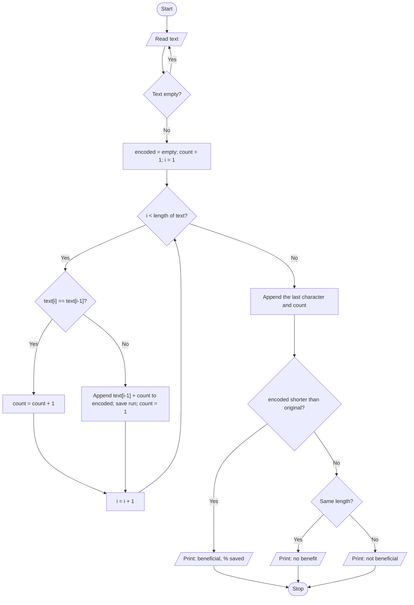

# Case Study 35: Text Compression Using Character Runs

[Back to main README](../README.md)

## 1. Problem Statement
Run-length encoding replaces each group of identical consecutive characters with the character followed by the length of the group (for example `aaabcc` becomes `a3b1c2`). Write a program that encodes a string this way, compares the original and encoded lengths and reports whether the encoding is beneficial, equal or longer than the original.

## 2. Objectives
- Traverse a string with indexes and compare neighbouring characters.
- Build a new string and a list of (character, count) tuples.
- Handle the final run correctly, which is a common source of bugs.
- Compare lengths and handle the cases where encoding does not help.

## 3. Assumptions
- The input is a non-empty string; an empty entry is rejected and asked again.
- Every run is written with its count, even when the count is 1.
- Upper and lower case letters are different characters.
- Only encoding is required (no decoding).

## 4. Algorithm
1. Read the text; repeat the prompt while it is empty.
2. Set `count = 1`.
3. For each index i from 1 to len-1, compare text[i] with text[i-1].
4. If equal, increase count; otherwise append text[i-1] and count to the encoded string, save the run tuple and reset count to 1.
5. After the loop, append the last character and its count.
6. Compare len(original) with len(encoded) and print the matching message with the percentage saved or lost.

## 5. Pseudocode
```text
START
  READ text (repeat while text is empty)
  encoded = "" ; runs = empty list ; count = 1
  FOR i = 1 TO length(text) - 1
      IF text[i] = text[i-1] THEN
          count = count + 1
      ELSE
          encoded = encoded + text[i-1] + count
          ADD (text[i-1], count) TO runs
          count = 1
  END FOR
  encoded = encoded + text[last] + count      // close the final run
  ADD (text[last], count) TO runs
  PRINT runs, original text, encoded text, both lengths
  IF length(encoded) < length(text) THEN PRINT "beneficial", % saved
  ELSE IF lengths are equal THEN PRINT "no benefit"
  ELSE PRINT "not beneficial", % longer
STOP
```

## 6. Flowchart


## 7. Python Source Code
File: [`programs/case35_run_length_encoding.py`](../programs/case35_run_length_encoding.py)

```python
# Case Study 35: Text Compression Using Character Runs (Run-Length Encoding)
# Concepts used: strings, loops, indexing, conditionals

text = input("Enter the text to compress: ")
while len(text) == 0:
    text = input("Text cannot be empty. Enter the text again: ")

# ---------- Encode: group consecutive repeated characters ----------
encoded = ""
runs = []                   # list of tuples (character, count)
count = 1
for i in range(1, len(text)):
    if text[i] == text[i - 1]:
        count = count + 1
    else:
        encoded = encoded + text[i - 1] + str(count)
        runs.append((text[i - 1], count))
        count = 1
# the last run is never closed inside the loop, so add it here
encoded = encoded + text[len(text) - 1] + str(count)
runs.append((text[len(text) - 1], count))

# ---------- Compare lengths ----------
original_length = len(text)
encoded_length = len(encoded)

print("\nRuns found   :", end=" ")
for character, number in runs:          # tuple unpacking
    print(f"({character!r} x {number})", end=" ")
print()
print("Original text:", text, f"(length {original_length})")
print("Encoded text :", encoded, f"(length {encoded_length})")

if encoded_length < original_length:
    saved = (original_length - encoded_length) / original_length * 100
    print(f"Result: Compression is BENEFICIAL. Saved {saved:.1f}% of the space.")
elif encoded_length == original_length:
    print("Result: Encoded length is EQUAL to the original. No benefit.")
else:
    extra = (encoded_length - original_length) / original_length * 100
    print(f"Result: Encoding is NOT beneficial ({extra:.1f}% longer). Keep the original text.")
```

## 8. Sample Run
Input used: Inputs in order: `aaabccdddd`

```text
Enter the text to compress: aaabccdddd

Runs found   : ('a' x 3) ('b' x 1) ('c' x 2) ('d' x 4) 
Original text: aaabccdddd (length 10)
Encoded text : a3b1c2d4 (length 8)
Result: Compression is BENEFICIAL. Saved 20.0% of the space.
```

## 9. Test Cases
| TC | Scenario / Input | Expected Output | Result |
|----|------------------|-----------------|--------|
| TC1 | `aaabccdddd`<br>Inputs in order: `aaabccdddd` | Encoded `a3b1c2d4` (8 vs 10): beneficial, 20.0% saved | Pass |
| TC2 | `abc` (no repeats)<br>Inputs in order: `abc` | Encoded `a1b1c1` (6 vs 3): NOT beneficial, 100.0% longer; keep original | Pass |
| TC3 | `aabb`<br>Inputs in order: `aabb` | Encoded `a2b2` (4 vs 4): equal length, no benefit | Pass |
| TC4 | Single character `a`<br>Inputs in order: `a` | Encoded `a1` (2 vs 1): not beneficial (loop never runs, last-run step handles it) | Pass |
| TC5 | Empty input, then `zzzzzzzz`<br>Inputs in order: `(just Enter)`, `zzzzzzzz` | Message 'Text cannot be empty', then `z8` (2 vs 8): 75.0% saved | Pass |

## 10. Output Screenshot
Run `python programs/case35_run_length_encoding.py`, take a screenshot of the terminal and save it as `screenshots/case35_run_length_encoding.png`. Then it will appear below.


## 11. Conclusion
The program encodes a string into character runs and honestly reports when compression does not help, such as for text with few repeats. The most important lesson was that the last run is never closed inside the loop, so it must be added after the loop; the single-character test case proves this works. Storing runs as (character, count) tuples also practised tuple creation and unpacking.
