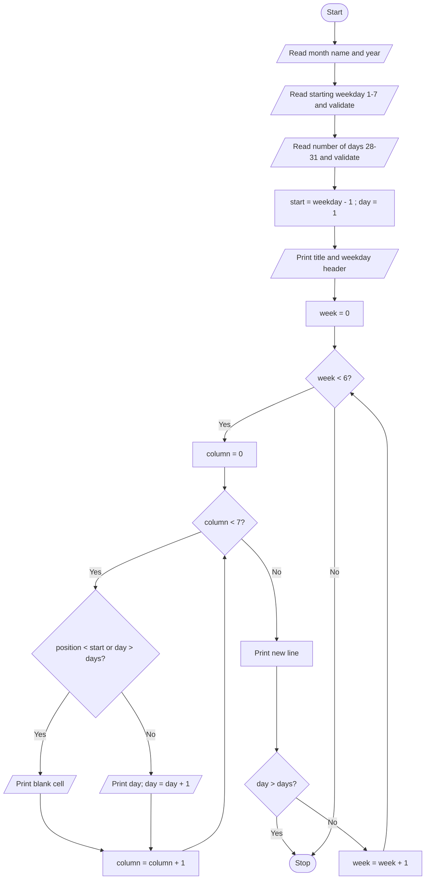

# Case Study 37: Nested Loop Calendar Generator

[Back to main README](../README.md)

## 1. Problem Statement
Generate a neatly formatted monthly calendar. The user supplies the month name, year, the weekday on which the month starts and the number of days in the month. The program prints the weekday header and the dates in correctly aligned weekly rows.

## 2. Objectives
- Use nested loops (weeks x weekdays) to produce a grid.
- Calculate blank cells before the first day of the month.
- Format output with fixed-width fields so columns stay aligned.
- Validate the starting weekday and month length.

## 3. Assumptions
- Weekdays are numbered 1 (Monday) to 7 (Sunday); the week starts on Monday.
- Valid month lengths are 28 to 31 days.
- The program does not check which month has how many days; it trusts the length given (leap years are handled by the user typing 29).
- A month needs at most 6 week rows.

## 4. Algorithm
1. Read month name and year (used only in the title).
2. Read the starting weekday (1-7) and the number of days (28-31), repeating until valid.
3. Set `start = weekday - 1` (number of blank cells before day 1) and `day = 1`.
4. Print the centred title, the weekday header and a line of dashes.
5. Outer loop: week = 0 to 5. Inner loop: column = 0 to 6.
6. position = week*7 + column. If position < start or day > days, print a blank cell; otherwise print the day and increase day.
7. After each week print a new line; stop early once day > days.

## 5. Pseudocode
```text
START
  READ month_name, year
  READ weekday  (repeat until 1 <= weekday <= 7)
  READ days     (repeat until 28 <= days <= 31)
  start = weekday - 1
  PRINT centred title, header "Mo Tu We Th Fr Sa Su", separator line
  day = 1
  FOR week = 0 TO 5
      FOR column = 0 TO 6
          position = week * 7 + column
          IF position < start OR day > days THEN
              PRINT 4 blank spaces
          ELSE
              PRINT day in width 4
              day = day + 1
      END FOR
      PRINT new line
      IF day > days THEN EXIT outer loop
  END FOR
STOP
```

## 6. Flowchart


## 7. Python Source Code
File: [`programs/case37_calendar_generator.py`](../programs/case37_calendar_generator.py)

```python
# Case Study 37: Nested Loop Calendar Generator
# Concepts used: nested loops, strings, conditionals, validation

DAY_NAMES = ["Mon", "Tue", "Wed", "Thu", "Fri", "Sat", "Sun"]

month_name = input("Enter month name (e.g. October): ")
year = input("Enter year (e.g. 2026): ")

text = input("Starting weekday (1=Mon, 2=Tue, ... 7=Sun): ")
while (not text.isdigit()) or int(text) < 1 or int(text) > 7:
    text = input("Invalid. Enter a number from 1 to 7: ")
start = int(text) - 1               # number of blank cells before day 1

text = input("Number of days in the month (28-31): ")
while (not text.isdigit()) or int(text) < 28 or int(text) > 31:
    text = input("Invalid. Enter a number from 28 to 31: ")
days = int(text)

# ---------- Heading ----------
title = month_name + " " + year
print()
print(title.center(28))
for name in DAY_NAMES:
    print(f"{name[:2]:>4}", end="")      # Mo Tu We ...
print()
print("-" * 28)

# ---------- Calendar body: rows = weeks, columns = weekdays ----------
day = 1
for week in range(6):                    # a month needs at most 6 weeks
    for column in range(7):
        position = week * 7 + column     # cell number counted from the first cell
        if position < start or day > days:
            print("    ", end="")        # empty cell
        else:
            print(f"{day:>4}", end="")
            day = day + 1
    print()                              # end of the week
    if day > days:
        break                            # stop once all days are printed
```

## 8. Sample Run
Input used: Inputs in order: `October`, `2026`, `4`, `31`

```text
Enter month name (e.g. October): October
Enter year (e.g. 2026): 2026
Starting weekday (1=Mon, 2=Tue, ... 7=Sun): 4
Number of days in the month (28-31): 31

        October 2026        
  Mo  Tu  We  Th  Fr  Sa  Su
----------------------------
               1   2   3   4
   5   6   7   8   9  10  11
  12  13  14  15  16  17  18
  19  20  21  22  23  24  25
  26  27  28  29  30  31
```

## 9. Test Cases
| TC | Scenario / Input | Expected Output | Result |
|----|------------------|-----------------|--------|
| TC1 | October 2026, starts Thursday (4), 31 days<br>Inputs in order: `October`, `2026`, `4`, `31` | Day 1 under 'Th'; last row `26 27 28 29 30 31` | Pass |
| TC2 | February 2026, starts Sunday (7), 28 days<br>Inputs in order: `February`, `2026`, `7`, `28` | Day 1 alone in the first row under 'Su'; last row ends with 28 | Pass |
| TC3 | Starts Monday (1), 28 days<br>Inputs in order: `February`, `2027`, `1`, `28` | Exactly 4 full rows, no extra blank row | Pass |
| TC4 | Starts Saturday (6), 31 days (needs 6 rows)<br>Inputs in order: `March`, `2025`, `6`, `31` | 6 rows; day 31 alone on the last row under 'Mo' | Pass |
| TC5 | Invalid inputs: weekday 0 and 8, then 3; days 27 and 32, then 30<br>Inputs in order: `April`, `2026`, `0`, `8`, `3`, `27`, `32`, `30` | Error messages shown; calendar for 30 days starting Wednesday | Pass |

## 10. Output Screenshot
Run `python programs/case37_calendar_generator.py`, take a screenshot of the terminal and save it as `screenshots/case37_calendar_generator.png`. Then it will appear below.


## 11. Conclusion
The program prints a clean, aligned calendar for any valid start weekday and month length. The expression `position = week * 7 + column` was the key idea: comparing it with the number of leading blanks decides whether a cell is empty or holds a date. Fixed-width formatting (`{day:>4}`) keeps single-digit and double-digit dates aligned, and the early exit prevents an unnecessary blank row.
