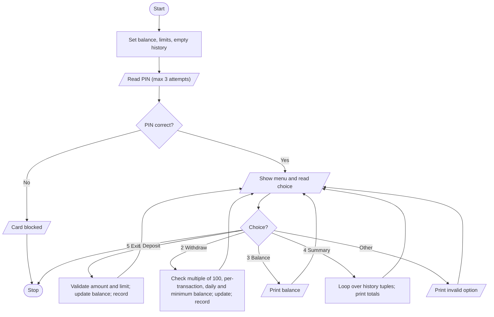

# Case Study 38: ATM Menu-Driven Banking Simulation

[Back to main README](../README.md)

## 1. Problem Statement
Simulate an ATM. After a PIN check, the customer repeatedly chooses from a menu: deposit, withdraw, check balance, view a transaction summary or exit. The program must validate every entry, enforce account limits and keep a history of all transactions (including rejected ones).

## 2. Objectives
- Use a `while` loop to build a menu-driven program.
- Apply several validation rules with if / elif / else.
- Store the transaction history as a list of tuples and unpack it for the summary.
- Handle invalid menu choices and invalid amounts without crashing.

## 3. Assumptions
- Opening balance is Rs.5000 and the correct PIN is 1234 (3 attempts allowed, then the card is blocked).
- Minimum balance that must remain: Rs.500.
- Maximum single deposit: Rs.50,000. Maximum single withdrawal: Rs.10,000. Daily withdrawal limit: Rs.20,000.
- Withdrawals must be multiples of Rs.100.
- Amounts must be positive whole numbers.
- The program runs one 'day' (the daily limit resets when the program is restarted).

## 4. Algorithm
1. Set the account constants, balance and an empty history list.
2. Ask for the PIN up to 3 times; if all fail, block the card and stop.
3. Repeat: show the menu and read the choice.
4. Deposit: validate the amount (positive whole number, within the deposit limit), add it to the balance and record it.
5. Withdraw: validate the amount (positive, multiple of 100, within the per-transaction limit, within the daily limit, minimum balance preserved); on success reduce the balance and record it, otherwise record the rejection reason.
6. Balance: print the current balance.
7. Summary: loop through the history, unpack each tuple, print it and total the successful deposits, withdrawals and rejected count.
8. Exit: stop the loop. Any other choice: print an error.

## 5. Pseudocode
```text
START
  SET CORRECT_PIN, limits, balance = 5000, withdrawn_today = 0
  history = empty list
  attempts = 0; verified = FALSE
  WHILE attempts < 3
      READ entered PIN
      IF entered = CORRECT_PIN THEN verified = TRUE; EXIT loop
      attempts = attempts + 1
  END WHILE
  IF NOT verified THEN PRINT "Card blocked"; STOP
  running = TRUE
  WHILE running
      PRINT menu; READ choice
      IF choice = "1" THEN                      // deposit
          READ amount
          IF not a positive whole number THEN reject
          ELSE IF amount > MAX_DEPOSIT THEN reject
          ELSE balance = balance + amount; record success
      ELSE IF choice = "2" THEN                 // withdraw
          READ amount
          IF invalid amount THEN reject
          ELSE IF amount MOD 100 != 0 THEN reject
          ELSE IF amount > MAX_WITHDRAW THEN reject
          ELSE IF withdrawn_today + amount > DAILY_LIMIT THEN reject
          ELSE IF balance - amount < MIN_BALANCE THEN reject
          ELSE balance = balance - amount; withdrawn_today += amount; record success
      ELSE IF choice = "3" THEN PRINT balance
      ELSE IF choice = "4" THEN
          FOR each (kind, amount, bal, status) IN history
              PRINT it; add to totals
          PRINT totals
      ELSE IF choice = "5" THEN running = FALSE
      ELSE PRINT "Invalid option"
  END WHILE
STOP
```

## 6. Flowchart


## 7. Python Source Code
File: [`programs/case38_atm_menu_simulation.py`](../programs/case38_atm_menu_simulation.py)

```python
# Case Study 38: ATM Menu-Driven Banking Simulation
# Concepts used: while loops, menus, conditionals, lists, tuples, validation

# ---------- Account settings ----------
CORRECT_PIN = "1234"
MAX_PIN_ATTEMPTS = 3
balance = 5000
MIN_BALANCE = 500           # balance that must always remain
MAX_DEPOSIT = 50000         # per deposit
MAX_WITHDRAW = 10000        # per withdrawal
DAILY_LIMIT = 20000         # total withdrawals per day
MULTIPLE = 100              # withdrawals must be a multiple of this
withdrawn_today = 0
history = []                # tuples: (type, amount, balance after, status)

# ---------- PIN check ----------
attempts = 0
verified = False
while attempts < MAX_PIN_ATTEMPTS:
    entered = input("Enter 4-digit PIN: ")
    if entered == CORRECT_PIN:
        verified = True
        break
    attempts = attempts + 1
    print("Incorrect PIN. Attempts left:", MAX_PIN_ATTEMPTS - attempts)

if not verified:
    print("Card blocked after too many wrong attempts.")
else:
    print("\nLogin successful.")
    running = True
    while running:
        print("\n1. Deposit   2. Withdraw   3. Balance   4. Summary   5. Exit")
        choice = input("Choose an option: ")

        if choice == "1":
            text = input("Enter deposit amount: ")
            if not text.isdigit() or int(text) == 0:
                print("Rejected: amount must be a positive whole number.")
                history.append(("Deposit", 0, balance, "Rejected - invalid amount"))
            elif int(text) > MAX_DEPOSIT:
                print(f"Rejected: maximum deposit is Rs.{MAX_DEPOSIT}.")
                history.append(("Deposit", int(text), balance, "Rejected - above deposit limit"))
            else:
                amount = int(text)
                balance = balance + amount
                print(f"Deposited Rs.{amount}. New balance: Rs.{balance}")
                history.append(("Deposit", amount, balance, "Success"))

        elif choice == "2":
            text = input("Enter withdrawal amount: ")
            if not text.isdigit() or int(text) == 0:
                print("Rejected: amount must be a positive whole number.")
                history.append(("Withdraw", 0, balance, "Rejected - invalid amount"))
            else:
                amount = int(text)
                if amount % MULTIPLE != 0:
                    print(f"Rejected: amount must be a multiple of {MULTIPLE}.")
                    status = "Rejected - not a multiple of 100"
                elif amount > MAX_WITHDRAW:
                    print(f"Rejected: maximum per withdrawal is Rs.{MAX_WITHDRAW}.")
                    status = "Rejected - above per-transaction limit"
                elif withdrawn_today + amount > DAILY_LIMIT:
                    print(f"Rejected: daily limit Rs.{DAILY_LIMIT} exceeded.")
                    status = "Rejected - daily limit exceeded"
                elif balance - amount < MIN_BALANCE:
                    print(f"Rejected: Rs.{MIN_BALANCE} minimum balance must remain.")
                    status = "Rejected - minimum balance"
                else:
                    balance = balance - amount
                    withdrawn_today = withdrawn_today + amount
                    print(f"Withdrawn Rs.{amount}. New balance: Rs.{balance}")
                    status = "Success"
                history.append(("Withdraw", amount, balance, status))

        elif choice == "3":
            print(f"Current balance: Rs.{balance}")

        elif choice == "4":
            deposits = 0
            withdrawals = 0
            rejected = 0
            print(f"\n{'No.':<5}{'Type':<10}{'Amount':<9}{'Balance':<9}Status")
            number = 1
            for record in history:
                kind, amount, bal, status = record      # tuple unpacking
                print(f"{number:<5}{kind:<10}{amount:<9}{bal:<9}{status}")
                number = number + 1
                if status == "Success":
                    if kind == "Deposit":
                        deposits = deposits + amount
                    else:
                        withdrawals = withdrawals + amount
                else:
                    rejected = rejected + 1
            print(f"Total deposited: Rs.{deposits} | Total withdrawn: Rs.{withdrawals} | Rejected: {rejected}")
            print(f"Withdrawn today: Rs.{withdrawn_today} of Rs.{DAILY_LIMIT} | Balance: Rs.{balance}")

        elif choice == "5":
            print("Thank you for banking with us.")
            running = False

        else:
            print("Invalid option. Please choose 1 to 5.")
```

## 8. Sample Run
Input used: Inputs in order: `1234`, `1`, `2000`, `2`, `1500`, `2`, `250`, `2`, `12000`, `1`, `60000`, `3`, `9`, `4`, `5`

```text
Enter 4-digit PIN: 1234

Login successful.

1. Deposit   2. Withdraw   3. Balance   4. Summary   5. Exit
Choose an option: 1
Enter deposit amount: 2000
Deposited Rs.2000. New balance: Rs.7000

1. Deposit   2. Withdraw   3. Balance   4. Summary   5. Exit
Choose an option: 2
Enter withdrawal amount: 1500
Withdrawn Rs.1500. New balance: Rs.5500

1. Deposit   2. Withdraw   3. Balance   4. Summary   5. Exit
Choose an option: 2
Enter withdrawal amount: 250
Rejected: amount must be a multiple of 100.

1. Deposit   2. Withdraw   3. Balance   4. Summary   5. Exit
Choose an option: 2
Enter withdrawal amount: 12000
Rejected: maximum per withdrawal is Rs.10000.

1. Deposit   2. Withdraw   3. Balance   4. Summary   5. Exit
Choose an option: 1
Enter deposit amount: 60000
Rejected: maximum deposit is Rs.50000.

1. Deposit   2. Withdraw   3. Balance   4. Summary   5. Exit
Choose an option: 3
Current balance: Rs.5500

1. Deposit   2. Withdraw   3. Balance   4. Summary   5. Exit
Choose an option: 9
Invalid option. Please choose 1 to 5.

1. Deposit   2. Withdraw   3. Balance   4. Summary   5. Exit
Choose an option: 4

No.  Type      Amount   Balance  Status
1    Deposit   2000     7000     Success
2    Withdraw  1500     5500     Success
3    Withdraw  250      5500     Rejected - not a multiple of 100
4    Withdraw  12000    5500     Rejected - above per-transaction limit
5    Deposit   60000    5500     Rejected - above deposit limit
Total deposited: Rs.2000 | Total withdrawn: Rs.1500 | Rejected: 3
Withdrawn today: Rs.1500 of Rs.20000 | Balance: Rs.5500

1. Deposit   2. Withdraw   3. Balance   4. Summary   5. Exit
Choose an option: 5
Thank you for banking with us.
```

## 9. Test Cases
| TC | Scenario / Input | Expected Output | Result |
|----|------------------|-----------------|--------|
| TC1 | Wrong PIN three times: 1111, 2222, 3333<br>Inputs in order: `1111`, `2222`, `3333` | 'Card blocked after too many wrong attempts.' and the program ends | Pass |
| TC2 | PIN 1234, check balance, exit<br>Inputs in order: `1234`, `3`, `5` | Current balance: Rs.5000 | Pass |
| TC3 | Deposit 2000<br>Inputs in order: `1234`, `1`, `2000`, `5` | Deposited Rs.2000. New balance: Rs.7000 | Pass |
| TC4 | Withdraw 250 (not a multiple of 100)<br>Inputs in order: `1234`, `2`, `250`, `5` | Rejected: amount must be a multiple of 100 | Pass |
| TC5 | Withdraw 12000 (above per-transaction limit)<br>Inputs in order: `1234`, `1`, `50000`, `2`, `12000`, `5` | Rejected: maximum per withdrawal is Rs.10000 | Pass |
| TC6 | Daily limit: deposit 50000, withdraw 10000 twice, then 100<br>Inputs in order: `1234`, `1`, `50000`, `2`, `10000`, `2`, `10000`, `2`, `100`, `5` | First two withdrawals succeed (total 20000); third rejected: daily limit Rs.20000 exceeded | Pass |
| TC7 | Withdraw 4600 from 5000 (would leave 400)<br>Inputs in order: `1234`, `2`, `4600`, `5` | Rejected: Rs.500 minimum balance must remain | Pass |
| TC8 | Invalid menu choice 9 and non-numeric deposit 'abc'<br>Inputs in order: `1234`, `9`, `1`, `abc`, `5` | 'Invalid option' and 'amount must be a positive whole number' | Pass |
| TC9 | Summary after a deposit and a rejected withdrawal<br>Inputs in order: `1234`, `1`, `1000`, `2`, `250`, `4`, `5` | Table with 2 records; total deposited Rs.1000, withdrawn Rs.0, rejected 1 | Pass |

## 10. Output Screenshot
Run `python programs/case38_atm_menu_simulation.py`, take a screenshot of the terminal and save it as `screenshots/case38_atm_menu_simulation.png`. Then it will appear below.


## 11. Conclusion
The ATM simulation behaves like a real machine: it blocks the card after repeated wrong PINs, validates every amount, enforces four different limits and records every transaction, including the rejected ones. The menu loop showed how `while` and `if/elif/else` work together to build interactive programs, and storing history as tuples made the summary simple to produce with tuple unpacking.
