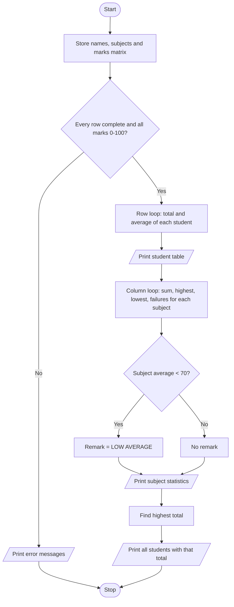

# Case Study 42: Student Marks Matrix Analysis

[Back to main README](../README.md)

## 1. Problem Statement
The marks of several students in several subjects are stored as a matrix (a nested list: one row per student, one column per subject). Write a program that validates the matrix, calculates row-wise statistics (total and average per student), column-wise statistics (average, highest, lowest and failures per subject), identifies the top performer(s) and flags subjects with a low class average.

## 2. Objectives
- Represent a table of data as a nested list and access it with `marks[row][col]`.
- Traverse the matrix row-wise and column-wise using nested loops.
- Validate that every row has the right size and every mark is within 0-100.
- Find maximum/minimum values and handle ties for the top performer.

## 3. Assumptions
- 6 students and 5 subjects, each mark out of 100.
- Pass mark is 40.
- A subject is flagged 'LOW AVERAGE' if the class average is below 70.
- Data is hard-coded in the program.

## 4. Algorithm
1. Store student names, subject names and the marks matrix.
2. Validate: every row has the same number of marks as there are subjects, and every mark is between 0 and 100. Stop with error messages if not.
3. Row-wise: for each student add up the marks, print them with total and average, and save the total in a list.
4. Column-wise: for each subject loop over all students to find the sum, highest, lowest and the number of marks below the pass mark; compute the average and flag if below the low-average limit.
5. Find the highest total and print every student who has it (so ties are shown).

## 5. Pseudocode
```text
START
  SET students, subjects, marks (nested list), LOW_AVERAGE, PASS_MARK
  rows = number of students; cols = number of subjects
  valid = TRUE
  FOR each row r
      IF length(marks[r]) != cols THEN print error; valid = FALSE
      ELSE FOR each column c
          IF marks[r][c] < 0 OR > 100 THEN print error; valid = FALSE
  IF valid THEN
      totals = empty list
      FOR each row r
          total = 0
          FOR each column c
              total = total + marks[r][c]
          ADD total TO totals; PRINT row, total, total / cols
      FOR each column c
          col_total = 0; highest = lowest = marks[0][c]; failures = 0
          FOR each row r
              update col_total, highest, lowest
              IF marks[r][c] < PASS_MARK THEN failures = failures + 1
          average = col_total / rows
          IF average < LOW_AVERAGE THEN remark = "LOW AVERAGE"
          PRINT subject statistics
      best = largest value in totals
      PRINT every student whose total = best
STOP
```

## 6. Flowchart


## 7. Python Source Code
File: [`programs/case42_marks_matrix_analysis.py`](../programs/case42_marks_matrix_analysis.py)

```python
# Case Study 42: Student Marks Matrix Analysis
# Concepts used: nested lists, nested loops, lists, conditionals

LOW_AVERAGE = 70        # subject average below this is flagged
PASS_MARK = 40

students = ["Asha", "Bala", "Chitra", "Dev", "Esha", "Farid"]
subjects = ["Maths", "Physics", "Chemistry", "English", "Python"]
marks = [                       # each row = one student, each column = one subject
    [78, 65, 82, 70, 90],
    [55, 48, 60, 52, 65],
    [92, 88, 95, 85, 98],
    [40, 35, 45, 50, 60],
    [67, 72, 58, 64, 70],
    [88, 79, 84, 90, 76],
]

rows = len(marks)
cols = len(subjects)

# ---------- Validate the matrix ----------
valid = True
for r in range(rows):
    if len(marks[r]) != cols:
        print("Error: row", r + 1, "does not have", cols, "marks")
        valid = False
    else:
        for c in range(cols):
            if marks[r][c] < 0 or marks[r][c] > 100:
                print(f"Error: invalid mark {marks[r][c]} for {students[r]} in {subjects[c]}")
                valid = False

if valid:
    # ---------- Row-wise statistics ----------
    totals = []
    print(f"{'Student':<9}", end="")
    for s in subjects:
        print(f"{s:<10}", end="")
    print(f"{'Total':<7}{'Avg':<7}")
    for r in range(rows):
        total = 0
        print(f"{students[r]:<9}", end="")
        for c in range(cols):
            total = total + marks[r][c]
            print(f"{marks[r][c]:<10}", end="")
        totals.append(total)
        print(f"{total:<7}{total / cols:<7.1f}")

    # ---------- Column-wise statistics ----------
    print("\nSubject statistics")
    print(f"{'Subject':<11}{'Average':<9}{'Highest':<9}{'Lowest':<8}{'Failures':<9}Remark")
    for c in range(cols):
        col_total = 0
        highest = marks[0][c]
        lowest = marks[0][c]
        failures = 0
        for r in range(rows):
            m = marks[r][c]
            col_total = col_total + m
            if m > highest:
                highest = m
            if m < lowest:
                lowest = m
            if m < PASS_MARK:
                failures = failures + 1
        average = col_total / rows
        remark = ""
        if average < LOW_AVERAGE:
            remark = "LOW AVERAGE"
        print(f"{subjects[c]:<11}{average:<9.1f}{highest:<9}{lowest:<8}{failures:<9}{remark}")

    # ---------- Top performer(s): handles ties ----------
    best = totals[0]
    for t in totals:
        if t > best:
            best = t
    print("\nTop performer(s) with total", best, ":", end=" ")
    for r in range(rows):
        if totals[r] == best:
            print(students[r], end=" ")
    print()
```

## 8. Sample Run
No input is needed; the data is stored in the program.

```text
Student  Maths     Physics   Chemistry English   Python    Total  Avg    
Asha     78        65        82        70        90        385    77.0   
Bala     55        48        60        52        65        280    56.0   
Chitra   92        88        95        85        98        458    91.6   
Dev      40        35        45        50        60        230    46.0   
Esha     67        72        58        64        70        331    66.2   
Farid    88        79        84        90        76        417    83.4   

Subject statistics
Subject    Average  Highest  Lowest  Failures Remark
Maths      70.0     92       40      0        
Physics    64.5     88       35      1        LOW AVERAGE
Chemistry  70.7     95       45      0        
English    68.5     90       50      0        LOW AVERAGE
Python     76.5     98       60      0        

Top performer(s) with total 458 : Chitra
```

## 9. Test Cases
| TC | Scenario / Input | Expected Output | Result |
|----|------------------|-----------------|--------|
| TC1 | Default data | Top performer Chitra (458); Physics (64.5) and English (68.5) flagged LOW AVERAGE | Pass |
| TC2 | Farid's marks changed to equal Chitra's | Tie: both Chitra and Farid printed as top performers | Pass |
| TC3 | Dev's Chemistry mark changed to 145 | Error: invalid mark 145 for Dev in Chemistry; no statistics printed | Pass |
| TC4 | Bala's row has only 4 marks | Error: row 2 does not have 5 marks | Pass |
| TC5 | LOW_AVERAGE changed to 60 | No subject is flagged (lowest average is 64.5) | Pass |

## 10. Output Screenshot
Run `python programs/case42_marks_matrix_analysis.py`, take a screenshot of the terminal and save it as `screenshots/case42_marks_matrix_analysis.png`. Then it will appear below.


## 11. Conclusion
The program shows how a nested list can represent a table and how two sets of nested loops give both row-wise and column-wise views of the same data. Validation before analysis prevents wrong results from bad data, and printing all students who share the highest total avoids unfairly choosing just one. The same pattern can be reused for any grid of numbers.
