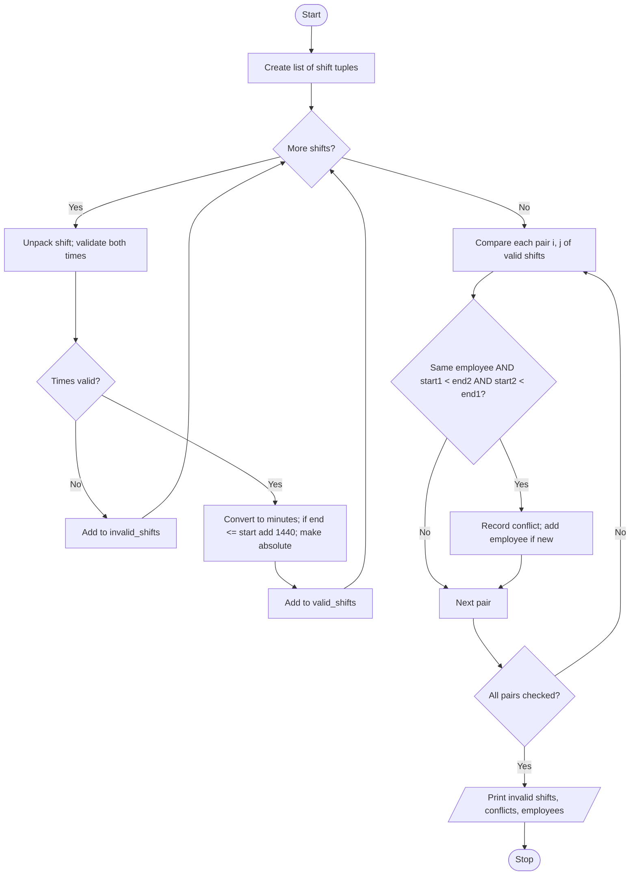

# Case Study 48: Tuple-Based Employee Shift Conflict Detection

[Back to main README](../README.md)

## 1. Problem Statement
A company stores employee shifts as tuples of (employee ID, day, start time, end time). Write a program that validates the shifts, converts times into comparable numbers, detects overlapping shifts of the same employee (including night shifts that end after midnight) and lists the employees who have conflicting schedules.

## 2. Objectives
- Represent records as tuples and use tuple unpacking.
- Parse 'HH:MM' strings using slicing and convert them to minutes.
- Detect overlapping time intervals with a simple mathematical rule.
- Handle overnight shifts and invalid time entries.

## 3. Assumptions
- Day is a number 0 (Monday) to 6 (Sunday).
- Times use 24-hour 'HH:MM' format.
- If the end time is earlier than or equal to the start time, the shift ends on the next day (night shift).
- Shifts that only touch (one ends exactly when the next starts) are NOT conflicts.
- Only shifts of the same employee are compared.

## 4. Algorithm
1. Store the shifts as a list of tuples.
2. For each shift, unpack it and validate both times (length 5, ':' in the middle, digits, hour <= 23, minute <= 59). Invalid shifts go to an `invalid_shifts` list.
3. Convert the start and end to minutes; if end <= start add 1440 minutes (24 hours).
4. Convert to absolute minutes from Monday 00:00: `day*1440 + minutes`.
5. Compare every pair of valid shifts; if they belong to the same employee and `start1 < end2 and start2 < end1`, they overlap: record the conflict.
6. Keep a list of employees with conflicts (without repeating the same employee).
7. Print the invalid shifts, the conflicts and the affected employees.

## 5. Pseudocode
```text
START
  CREATE list shifts of tuples (employee, day, start, end)
  FOR each shift IN shifts
      UNPACK emp, day, start, end
      IF start or end is not a valid "HH:MM" THEN add shift to invalid_shifts
      ELSE
          start_min = hours*60 + minutes of start
          end_min   = hours*60 + minutes of end
          IF end_min <= start_min THEN end_min = end_min + 1440
          abs_start = day*1440 + start_min
          abs_end   = day*1440 + end_min
          ADD (emp, day, start, end, abs_start, abs_end) TO valid_shifts
  END FOR
  FOR i = 0 TO n-1
      FOR j = i+1 TO n-1
          UNPACK both shifts
          IF same employee AND a1 < b2 AND a2 < b1 THEN
              ADD conflict; ADD employee to conflicted list if new
  PRINT invalid shifts, conflicts, conflicted employees
STOP
```

## 6. Flowchart


## 7. Python Source Code
File: [`programs/case48_shift_conflict_detection.py`](../programs/case48_shift_conflict_detection.py)

```python
# Case Study 48: Tuple-Based Employee Shift Conflict Detection
# Concepts used: tuples, tuple unpacking, lists, strings, nested loops, conditionals

DAY_NAMES = ["Mon", "Tue", "Wed", "Thu", "Fri", "Sat", "Sun"]

# Each shift is a tuple: (employee, day number 0=Mon.., start "HH:MM", end "HH:MM")
shifts = [
    ("E01", 0, "09:00", "17:00"),
    ("E01", 0, "16:00", "20:00"),   # overlaps the first Monday shift
    ("E02", 1, "22:00", "06:00"),   # night shift: ends next morning
    ("E02", 2, "05:00", "09:00"),   # overlaps the night shift (05:00-06:00)
    ("E03", 3, "08:00", "12:00"),
    ("E03", 3, "12:00", "16:00"),   # touches but does NOT overlap
    ("E04", 4, "09:00", "13:00"),
    ("E04", 4, "25:00", "30:00"),   # invalid time
    ("E01", 5, "10:00", "14:00"),
]

# Step 1: validate each shift and convert it to absolute minutes from Monday 00:00
valid_shifts = []       # tuples: (employee, day, start_text, end_text, abs_start, abs_end)
invalid_shifts = []

for shift in shifts:
    emp, day, start, end = shift                    # tuple unpacking
    good = True
    for t in (start, end):
        if len(t) != 5 or t[2] != ":" or not t[0:2].isdigit() or not t[3:5].isdigit():
            good = False
        elif int(t[0:2]) > 23 or int(t[3:5]) > 59:
            good = False

    if not good:
        invalid_shifts.append(shift)
    else:
        start_min = int(start[0:2]) * 60 + int(start[3:5])
        end_min = int(end[0:2]) * 60 + int(end[3:5])
        if end_min <= start_min:                    # shift ends after midnight
            end_min = end_min + 24 * 60
        abs_start = day * 1440 + start_min
        abs_end = day * 1440 + end_min
        valid_shifts.append((emp, day, start, end, abs_start, abs_end))

# Step 2: compare every pair of shifts of the same employee
conflicts = []
conflicted_employees = []
for i in range(len(valid_shifts)):
    for j in range(i + 1, len(valid_shifts)):
        e1, d1, s1, t1, a1, b1 = valid_shifts[i]
        e2, d2, s2, t2, a2, b2 = valid_shifts[j]
        if e1 == e2 and a1 < b2 and a2 < b1:        # interval overlap rule
            conflicts.append((e1, DAY_NAMES[d1] + " " + s1 + "-" + t1,
                              DAY_NAMES[d2] + " " + s2 + "-" + t2))
            if e1 not in conflicted_employees:
                conflicted_employees.append(e1)

# Step 3: report
print("Invalid shift records:", len(invalid_shifts))
for emp, day, start, end in invalid_shifts:
    print(f"   {emp} {DAY_NAMES[day]} {start}-{end}  -> invalid time format/value")

print("\nShift conflicts found:", len(conflicts))
for emp, first, second in conflicts:
    print(f"   {emp}: {first}  overlaps  {second}")

print("\nEmployees with conflicting schedules:", conflicted_employees)
```

## 8. Sample Run
No input is needed; the data is stored in the program.

```text
Invalid shift records: 1
   E04 Fri 25:00-30:00  -> invalid time format/value

Shift conflicts found: 2
   E01: Mon 09:00-17:00  overlaps  Mon 16:00-20:00
   E02: Tue 22:00-06:00  overlaps  Wed 05:00-09:00

Employees with conflicting schedules: ['E01', 'E02']
```

## 9. Test Cases
| TC | Scenario / Input | Expected Output | Result |
|----|------------------|-----------------|--------|
| TC1 | Default data (9 shifts) | 1 invalid shift (E04); 2 conflicts (E01 on Monday, E02 Tue night shift vs Wed morning); employees ['E01', 'E02'] | Pass |
| TC2 | E03 shifts 08-12 and 12-16 touch but do not overlap | E03 does NOT appear in the conflicts list | Pass |
| TC3 | E03's second shift changed to start at 11:59 | Overlap of 1 minute detected; employees ['E01', 'E02', 'E03'] | Pass |
| TC4 | E04's invalid shift changed to 09:60-10:00 | Reported invalid because minutes are above 59 | Pass |
| TC5 | E02's Wednesday shift moved to 06:00-09:00 (starts when the night shift ends) | No conflict for E02; employees ['E01'] | Pass |

## 10. Output Screenshot
Run `python programs/case48_shift_conflict_detection.py`, take a screenshot of the terminal and save it as `screenshots/case48_shift_conflict_detection.png`. Then it will appear below.


## 11. Conclusion
The program uses tuples to keep each shift together and unpacking to read the fields naturally. Converting times to absolute minutes turned a difficult time-comparison problem into a simple numeric rule (`start1 < end2 and start2 < end1`), and adding 1440 minutes for night shifts handled shifts that cross midnight. The test cases confirm that touching shifts are accepted, one-minute overlaps are caught and invalid times are reported.
