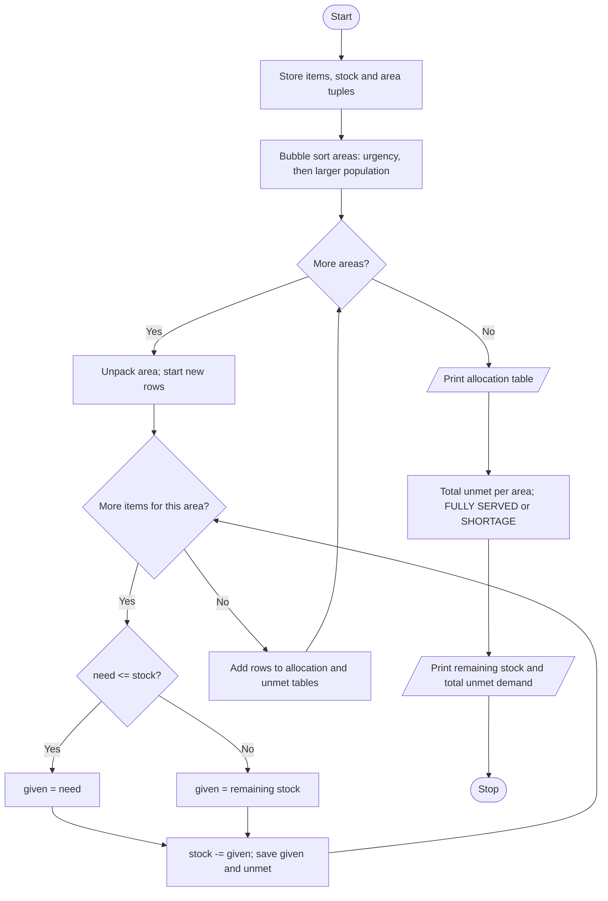

# Case Study 94: Disaster Relief Supply Allocation

[Back to main README](../README.md)

## 1. Problem Statement
After a disaster, a relief centre has a limited stock of supplies (food, water, medicine, blankets) and several affected areas, each with an urgency level, a population and a list of needs. Write a program that prioritises the areas, allocates the limited stock according to a fixed policy, shows what each area received and calculates the unmet demand and the remaining stock.

## 2. Objectives
- Use a nested list for the allocation and unmet-demand tables.
- Store areas as tuples and unpack them in loops.
- Sort the areas by priority with a manual sorting algorithm.
- Allocate limited resources with conditional logic and report shortages.

## 3. Assumptions
- Stock items: Food packets 500, Water cans 300, Medicine kits 100, Blankets 250.
- Urgency 1 is the most urgent, 3 the least urgent.
- Policy: areas are served in order of urgency; areas with equal urgency are served by larger population first.
- Each area receives what it needs, or whatever stock is left if the stock is not enough (partial allocation).
- Allocation is done item by item.

## 4. Algorithm
1. Store the item names, stock list and the area tuples (name, urgency, population, needs list).
2. Sort the areas with bubble sort: lower urgency number first; if equal, larger population first.
3. For each area (in sorted order), for each item: give = need if need <= stock else the remaining stock.
4. Reduce the stock by `give`; store `give` in the allocation table and `need - give` in the unmet table.
5. Print the allocation table, the unmet demand per area (marking FULLY SERVED or SHORTAGE), the remaining stock and the total unmet demand.

## 5. Pseudocode
```text
START
  SET items, stock list
  CREATE list areas of tuples (name, urgency, population, needs)
  // priority sort
  FOR i = 0 TO n-2
      FOR j = 0 TO n-2-i
          IF areas[j+1].urgency < areas[j].urgency
             OR (same urgency AND areas[j+1].population > areas[j].population)
              SWAP areas[j], areas[j+1]
  allocation = empty nested list; unmet = empty nested list
  FOR each area IN areas
      UNPACK name, urgency, population, needs
      given_row = empty; unmet_row = empty
      FOR each item k
          IF needs[k] <= stock[k] THEN given = needs[k] ELSE given = stock[k]
          stock[k] = stock[k] - given
          ADD given TO given_row; ADD needs[k] - given TO unmet_row
      ADD given_row TO allocation; ADD unmet_row TO unmet
  PRINT allocation table
  FOR each area: total unmet = sum of its unmet row
      PRINT FULLY SERVED if 0, else SHORTAGE
  PRINT remaining stock and total unmet demand
STOP
```

## 6. Flowchart


## 7. Python Source Code
File: [`programs/case94_relief_supply_allocation.py`](../programs/case94_relief_supply_allocation.py)

```python
# Case Study 94: Disaster Relief Supply Allocation
# Concepts used: nested lists, tuples, tuple unpacking, loops, conditionals, sorting

items = ["Food packets", "Water cans", "Medicine kits", "Blankets"]
stock = [500, 300, 100, 250]            # available quantity of each item

# Each area is a tuple: (name, urgency 1=highest..3=lowest, population, [needs per item])
areas = [
    ("Riverside", 1, 1200, [300, 150, 60, 100]),
    ("Hilltop",   2,  800, [200, 100, 30, 80]),
    ("Lakeside",  1, 1500, [250, 120, 40, 90]),
    ("Old Town",  3,  600, [150, 80, 20, 60]),
    ("Farmland",  2,  900, [180, 90, 25, 70]),
]

# ---------- Step 1: priority order (bubble sort) ----------
# Policy: lower urgency number first; if equal, larger population first.
n = len(areas)
for i in range(n - 1):
    for j in range(n - 1 - i):
        a = areas[j]
        b = areas[j + 1]
        if b[1] < a[1] or (b[1] == a[1] and b[2] > a[2]):
            areas[j], areas[j + 1] = b, a

# ---------- Step 2: allocate in priority order ----------
allocation = []     # nested list: allocation[area][item]
unmet = []          # nested list: unmet[area][item]
for area in areas:
    name, urgency, population, needs = area         # tuple unpacking
    given_row = []
    unmet_row = []
    for k in range(len(items)):
        if needs[k] <= stock[k]:
            given = needs[k]
        else:
            given = stock[k]                        # give whatever is left
        stock[k] = stock[k] - given
        given_row.append(given)
        unmet_row.append(needs[k] - given)
    allocation.append(given_row)
    unmet.append(unmet_row)

# ---------- Step 3: report ----------
print("Allocation order (priority): ", end="")
for area in areas:
    print(area[0], end="  ")
print("\n")

print(f"{'Area':<11}{'Urg':<5}", end="")
for it in items:
    print(f"{it:<15}", end="")
print()
for r in range(n):
    print(f"{areas[r][0]:<11}{areas[r][1]:<5}", end="")
    for k in range(len(items)):
        print(f"{allocation[r][k]:<15}", end="")
    print()

print("\nUnmet demand")
total_unmet = 0
for r in range(n):
    area_unmet = 0
    for k in range(len(items)):
        area_unmet = area_unmet + unmet[r][k]
    total_unmet = total_unmet + area_unmet
    if area_unmet == 0:
        note = "FULLY SERVED"
    else:
        note = "SHORTAGE"
    print(f"{areas[r][0]:<11}{unmet[r]}  total={area_unmet:<5}{note}")

print("\nStock remaining:", end=" ")
for k in range(len(items)):
    print(f"{items[k]}={stock[k]}", end="  ")
print(f"\nTotal unmet demand across all areas: {total_unmet}")
```

## 8. Sample Run
No input is needed; the data is stored in the program.

```text
Allocation order (priority): Lakeside  Riverside  Farmland  Hilltop  Old Town  

Area       Urg  Food packets   Water cans     Medicine kits  Blankets       
Lakeside   1    250            120            40             90             
Riverside  1    250            150            60             100            
Farmland   2    0              30             0              60             
Hilltop    2    0              0              0              0              
Old Town   3    0              0              0              0              

Unmet demand
Lakeside   [0, 0, 0, 0]  total=0    FULLY SERVED
Riverside  [50, 0, 0, 0]  total=50   SHORTAGE
Farmland   [180, 60, 25, 10]  total=275  SHORTAGE
Hilltop    [200, 100, 30, 80]  total=410  SHORTAGE
Old Town   [150, 80, 20, 60]  total=310  SHORTAGE

Stock remaining: Food packets=0  Water cans=0  Medicine kits=0  Blankets=0  
Total unmet demand across all areas: 1045
```

## 9. Test Cases
| TC | Scenario / Input | Expected Output | Result |
|----|------------------|-----------------|--------|
| TC1 | Default data | Order: Lakeside, Riverside, Farmland, Hilltop, Old Town; total unmet demand 1045 | Pass |
| TC2 | Stock increased to 5000, 3000, 1000, 2500 | All five areas FULLY SERVED; total unmet 0 | Pass |
| TC3 | Stock is zero for every item | Nothing allocated; total unmet = total need = 2195 | Pass |
| TC4 | Old Town urgency changed from 3 to 1 | Old Town is served third (urgency 1, smaller population): Lakeside, Riverside, Old Town, Farmland, Hilltop | Pass |
| TC5 | Stock exactly equals total demand: 1080, 540, 175, 400 | Everyone fully served and every remaining stock = 0 | Pass |

## 10. Output Screenshot
Run `python programs/case94_relief_supply_allocation.py`, take a screenshot of the terminal and save it as `screenshots/case94_relief_supply_allocation.png`. Then it will appear below.


## 11. Conclusion
The program applies a clear priority policy to share limited relief supplies and shows exactly who is served, who is short and by how much. The nested lists `allocation` and `unmet` made it easy to print area-by-item tables, while tuples kept each area's data together. Changing only the stock list or an urgency value showed how the plan responds, and the test cases confirm the boundary situations (zero stock, exact stock, surplus stock).
